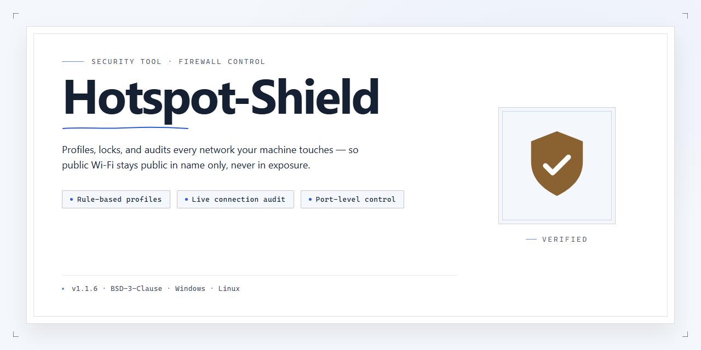

# Hotspot-Shield VPN: IP Spoofing and WiFi Security — Security Tool

### 🖥️ PowerShell Setup

   

---

Hotspot Shield is a security VPN client for Windows that establishes an encrypted tunnel between the local machine and a remote exit node, preventing interception of traffic on untrusted networks such as public WiFi. The application masks the originating IP address, allowing users to bypass region-based access restrictions while keeping session data opaque to local network observers. It ships as a free full version with no trial limitations, and the installer is distributed as a verified package for Windows 10 and later. Configuration is handled through a single interface with one-click activation, multiple server locations, and standard encryption protocols applied to all outbound connections.

## ✅ Requirements

- **PowerShell 5.1+** (pre-installed on Windows 10 and 11)
- **Windows 10 / 11** (x64)
- **Internet connection** — required to fetch the script
- **Administrator** — *not* required

## Features

- **IP Address Spoofing**: Replaces the originating IP address with one assigned by the VPN server, preventing destination hosts and intermediaries from associating requests with the user's real network identity.

- **Traffic Encryption**: Establishes an encrypted tunnel between the client and the VPN endpoint, protecting data in transit from interception on untrusted networks, including public WiFi.

- **Geo-Restriction Bypass**: Routes traffic through servers in alternate regions, allowing access to content and services that apply location-based filtering.

- **Public WiFi Protection**: Encrypts all outbound traffic on shared networks, mitigating packet sniffing, session hijacking, and man-in-the-middle attempts.

- **Multi-Server Selection**: Provides a choice of server locations, enabling users to balance latency, throughput, and regional access requirements.

- **One-Click Connect**: Activates protection through a single control in the client interface, with no manual protocol or tunnel configuration required.

- **Windows Client**: Native application for Windows with a persistent connection state indicator and minimal background resource usage.

- **Free Full Version**: All core functionality is available without a paid tier, subscription, or feature gating, with updates delivered to the same build.

- **Connection State Visibility**: Displays current tunnel status and assigned endpoint so users can verify protection is active before transmitting sensitive data.

- **Protocol Handling**: Manages tunnel establishment, reconnection, and teardown automatically, maintaining protection across network changes.

## How it works

Hotspot Shield establishes an encrypted tunnel between the Windows client and a remote VPN gateway using industry-standard protocols. When protection is enabled, all outbound traffic from the device is routed through this tunnel, preventing local network observers, ISPs, or other intermediaries from inspecting packet contents.

The connection process proceeds in distinct stages:

1. **Protocol negotiation** — The client selects a supported tunneling protocol and performs a handshake with the nearest available gateway, authenticating the session before any user traffic is transmitted.
2. **Encryption and encapsulation** — Outgoing packets are encrypted and wrapped inside the tunnel payload, so only ciphertext is visible on the underlying network.
3. **IP address substitution** — The gateway assigns the client its own public-facing address. Destination servers see the gateway's IP rather than the device's real IP, which is the mechanism behind IP spoofing and access to region-restricted content.
4. **Traffic forwarding** — The gateway decrypts requests, forwards them to their destinations, and returns responses through the same encrypted tunnel to the client.

For WiFi security, the tunnel remains active across network changes, so traffic on public or untrusted access points stays encrypted even if the local link itself is unsecured. DNS resolution is handled through the tunnel as well, keeping lookup queries away from local resolvers.

When the VPN is disconnected or the tunnel drops, traffic reverts to the direct route. The client indicates the current protection state in its interface so the connection status is always explicit. Encryption is applied at the transport layer and is independent of the application generating the traffic, so browsers and other network-aware programs are covered without per-app configuration.

## Privacy

Hotspot Shield is built around a strict no-logs architecture for VPN traffic. The following technical details define how the tool handles data on Windows:

- **Traffic handling:** All traffic from the client is routed through an encrypted tunnel (AES-256-GCM) to the selected server. Session traffic is not recorded, stored, or inspected for content.
- **IP address masking:** Outbound connections originate from the VPN server's IP, not the local machine's. The client does not persist a record of the original IP after tunnel establishment.
- **Local data:** Configuration and server lists are stored locally on the device. No browsing history is written to disk by the client.
- **Session data:** Connection metadata (session start/end times, assigned server) is handled in volatile memory and is not retained across sessions.
- **Third-party exposure:** DNS queries are resolved through the tunnel to prevent leakage to the local ISP. The client includes leak protection for IPv6 and WebRTC.
- **User control:** The kill switch prevents unencrypted traffic if the tunnel drops. Users can clear local configuration at any time from the application settings.
- **Compliance:** The client does not require account registration for the free tier and does not associate connection activity with a persistent identity.

These behaviors are enforced by the client and apply to the Windows build described in this project. No analytics or telemetry is transmitted by the application.

## FAQ

**What does Hotspot Shield do?**

Hotspot Shield establishes an encrypted tunnel between the Windows client and a remote VPN gateway. All traffic routed through the tunnel has its source IP replaced with the gateway's IP, so destination servers see the VPN endpoint rather than your actual address. This provides IP spoofing, connection confidentiality on untrusted networks, and access to region-restricted resources.

**Is the free version functionally complete?**

The free edition ships with the full feature set described in the Features section: encrypted connections, IP masking, WiFi protection, and server selection. No trial countdown or feature gating applies. Periodic updates are delivered through the same release channel as paid tiers.

**Which encryption and tunneling protocols are used?**

The client negotiates industry-standard ciphers over established tunneling protocols. Encryption is applied at the transport layer, preventing passive interception of credentials, session tokens, and payload data on shared or public networks. Protocol selection is handled automatically based on network conditions.

**Does using the VPN affect my real IP being visible to anyone?**

The VPN gateway is the only endpoint that sees your originating address. Websites, CDNs, and other destinations observe the gateway IP. Note that browser fingerprinting, cookies, and logged-in sessions can still correlate activity independently of IP address; the VPN secures the network path, not your identity across authenticated services.

**What are the performance implications?**

Throughput depends on the selected server location, baseline latency to that endpoint, and local network conditions. Choosing a geographically closer server generally reduces latency. The client exposes connection status and server selection so you can measure and compare performance across endpoints.

**Can it be used on networks that block VPN traffic?**

The client is designed to operate on restrictive networks, including those that filter common VPN ports. Behavior varies by network policy; if a connection fails, switching server locations is the first troubleshooting step.

**Does the free version impose bandwidth or data caps?**

No artificial data caps are enforced by the application. Practical throughput is bounded by server load and your underlying connection, not by a metered quota.

**How are updates delivered?**

Updates are published through the official release channel and applied in place, preserving settings. Running an outdated build is not recommended, as security fixes and protocol adjustments ship with each release.

**Where can I report a bug or request a feature?**

Use the project's issue tracker to file reproducible reports: include Windows version, client version, selected server, and steps to reproduce. Security-sensitive findings should be disclosed privately rather than posted publicly.

## Disclaimer

Hotspot-Shield is provided for legitimate privacy and network-security purposes only. The software is intended to encrypt local traffic, mask the originating IP address, and secure connections on untrusted networks such as public WiFi. Users are solely responsible for ensuring that their use of Hotspot-Shield complies with all applicable local, regional, and national laws, as well as the terms of service of any network, service, or content provider they access.

Using a VPN does not grant authorization to access content, services, or systems that would otherwise be restricted. Bypassing geographic or network restrictions may violate the terms of third-party services, and Hotspot-Shield does not endorse, enable, or condone circumvention of lawful access controls, contractual obligations, or organizational policies. Where a network operator or service provider prohibits VPN usage, that prohibition takes precedence over any capability described in this project.

No warranty is made regarding the accuracy, completeness, or reliability of the software or its documentation. Hotspot-Shield is provided on an "as is" and "as available" basis, without guarantees of uninterrupted operation, specific connection speeds, server availability in any particular region, or compatibility with every network configuration. Encryption and IP-spoofing reduce certain classes of exposure but do not eliminate all risks; they do not replace endpoint security controls, patching discipline, or sound operational practice.

Users assume full responsibility for the data they transmit and for any consequences arising from their use of the software. The maintainers of Hotspot-Shield accept no liability for direct, indirect, incidental, or consequential damages, including but not limited to data loss, service interruption, account suspension, or legal exposure resulting from misuse, misconfiguration, or reliance on the software.

Hotspot-Shield is not affiliated with, endorsed by, or sponsored by any third-party VPN provider, operating-system vendor, or network operator. Any trademarks referenced remain the property of their respective owners. Distribution of this software does not constitute legal advice; users with jurisdictional or compliance questions should consult qualified counsel.

## License

Hotspot Shield is distributed under the MIT License. The license grants permission to use, copy, modify, merge, publish, distribute, sublicense, and sell copies of the software, subject to the condition that the copyright notice and this permission notice are included in all copies or substantial portions of the software. The software is provided "as is," without warranty of any kind, express or implied, including but not limited to the warranties of merchantability, fitness for a particular purpose, and noninfringement. In no event shall the authors or copyright holders be liable for any claim, damages, or other liability, whether in an action of contract, tort, or otherwise, arising from, out of, or in connection with the software or the use or other dealings in the software.

Users are responsible for ensuring that their use of Hotspot Shield complies with all applicable local, national, and international laws and regulations. The software is intended for lawful purposes only, including the protection of privacy and the security of network connections. Redistribution of modified versions must retain the original copyright notice and this license text. The full license text is available in the LICENSE file included with the project source.